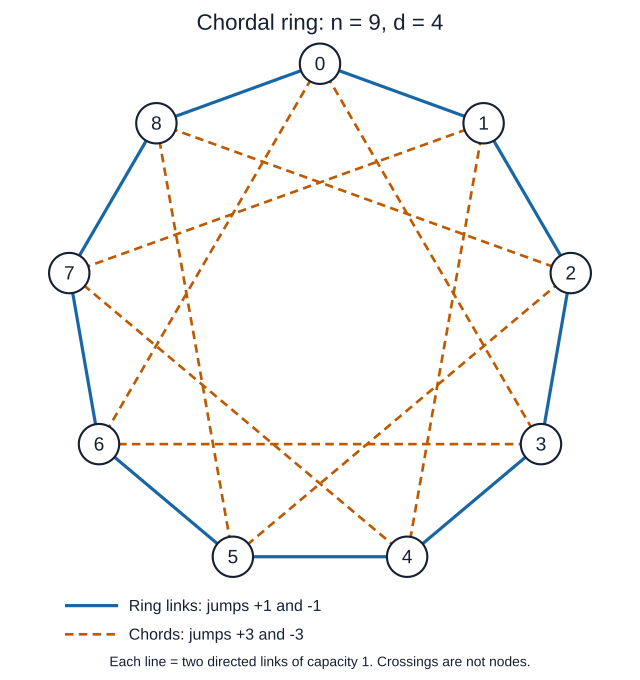

## 6. Worked optimal example: n = 9, d = 4

### Step 1: Connect the nodes

There are 9 nodes, labeled 0 through 8. Each node has 4 outgoing links
and 4 incoming links. Every directed link has capacity 1.

Connect each node to the nodes 1 step forward, 1 step backward,
3 steps forward, and 3 steps backward:

```text
S = {+1, -1, +3, -3} = {1, 8, 3, 6} modulo 9.
```

For example, node 0 connects directly to nodes `1, 8, 3, 6`.
Labels wrap around: one step backward from node 0 reaches node 8.
Every other node uses the same pattern.



**Figure 1.** Chordal ring for `n = 9, d = 4`. Solid blue lines are
neighbor connections (`+1, -1`); dashed orange lines are chords (`+3, -3`).
Each drawn line represents **two opposite directed links**, each with
capacity 1. Each node therefore has four outgoing and four incoming links.
Line crossings are not additional nodes or switches.

### Step 2: Choose routes

From node 0, send traffic to nodes `1, 3, 6, 8` directly, using one link.
Reach the other four destinations using two links:

| Displacement | Jump sequence | Example from node 0 |
|---|---|---|
| 2 | `+3, -1` | `0 -> 3 -> 2` |
| 4 | `+1, +3` | `0 -> 1 -> 4` |
| 5 | `-1, -3` | `0 -> 8 -> 5` |
| 7 | `-3, +1` | `0 -> 6 -> 7` |

Use the same routes from every source, shifting the node labels.
For example, the route to a destination 2 positions ahead is
`0 -> 3 -> 2` from node 0, and `1 -> 4 -> 3` from node 1.

### Step 3: Show that lambda = 2/3 fits on every link

Each source sends equally to the other 8 nodes. The original demand
for each source-destination pair is:

```text
Demand per pair = d/(n-1) = 4/8 = 1/2.
Scaled demand per pair = lambda/2.
```

The chosen routes make every directed link carry exactly three pairs'
traffic. Here is why:

- Each jump type appears once among the four direct routes.
- Each jump type appears twice across the four two-link routes in the table.
- Repeating these routes from all 9 sources spreads each occurrence once
  over every link of that jump type. Thus each individual link is used by
  three source-destination routes.

For a concrete check, the link `0 -> 1` carries these three routes:

| Source-destination pair | Complete route |
|---|---|
| 0 to 1 | `0 -> 1` |
| 0 to 4 | `0 -> 1 -> 4` |
| 3 to 1 | `3 -> 0 -> 1` |

All other links also carry three pairs' traffic under the chosen routing.
Therefore:

```text
Load on each link = 3 * (lambda/2).

At lambda = 2/3:
    traffic per pair = (2/3)/2 = 1/3
    load on each link = 3 * (1/3) = 1.
```

Every link has capacity 1, so this routing works: the graph achieves
`lambda = 2/3`.

### Step 4: Show that no topology can exceed lambda = 2/3

This argument applies to any allowed topology, not just our ring.

```text
Total directed links = 9 * 4 = 36.
Total link capacity = 36.
Total ordered source-destination pairs = 9 * 8 = 72.
```

At most 36 pairs have a direct link, so at least 36 pairs need two or
more links. Sending traffic through two links consumes capacity on both.
Consequently, even the best possible routing needs at least:

```text
Total capacity used
    >= (lambda/2) * [36 * 1 + 36 * 2]
     = (lambda/2) * 108
     = 54 * lambda.
```

The network has only 36 units of total link capacity:

```text
54 * lambda <= 36
lambda <= 36/54
lambda <= 2/3.
```

### Conclusion

**No topology can exceed 2/3, and our chordal ring actually achieves 2/3
without overloading any link. Therefore, it is optimal for n = 9, d = 4.**

The specific routes in the table are important: they balance the traffic
across all links. Short paths alone would not prove this.

## 7. What can be concluded for general n and d

The construction always gives a valid strongly connected degree-`d` graph,
and translated routing gives a precise, verifiable achievable flow.
For `d = n-1`, the complete graph attains `lambda = 1`.
For `d = 1`, the directed cycle is the only strongly connected allowed
topology up to relabeling, and attains `lambda = 2/n`.

For other parameters, neither divisibility nor ring symmetry guarantees
that the universal bound is attainable. A source can reach at most `d`
nodes in one hop and at most `d^2` more in two hops. If
`n-1 > d+d^2`, some pairs necessarily require at least three hops, making
the one/two-hop bound strictly unattainable.

The exact optimization implementation in
[uniform_topology.py](./uniform_topology.py) remains available as a separate
comparison tool. It searches over all allowed graphs; it is not the chordal
ring construction described here.

**Report conclusion:** chordal rings combine regularity, local connectivity,
and shortcuts, making them a defensible design for uniform traffic.
The explicit capacity calculation proves feasibility, and a matching upper
bound proves optimality in the worked example. A general claim of maximum
concurrent flow still requires a parameter-specific matching bound or an
additional structural optimality argument.
