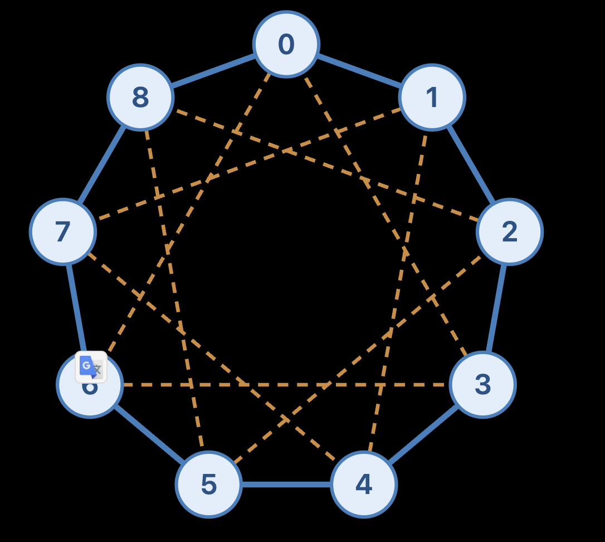

there are n x d directed links each with capacity 1. Total available link capacity = n x d
There are n x (n-1)  source-destination pairs
Each node has d outgoing links, so across n nodes there are n × d links. Each link directly connects just one ordered pair. Therefore, at most n × d pairs have a direct connection.

For any pair:

With a direct link: traffic can travel A → B, using 1 link.
Without a direct link: traffic must pass through another node, such as A → C → B, using at least 2 links. Some routes may need more.

Every pair carries lambda × d / (n − 1) units. Therefore:
Minimum total link usage
= lambda × d/(n − 1)× [n×d + 2×(n×(n − 1) − n×d)]
n×(n − 1) = total ordered source-destination pairs.
n×d = maximum number of directly connected pairs. Count 1 link for each.
n×(n − 1) − n×d = remaining pairs. Count at least 2 links for each.
Minimum link traversals = 14×1 + 28×2 = 70
Traffic per pair        = lambda × 1/3

Total link usage ≥ lambda × 1/3 × 70

Usage cannot exceed capacity
lambda × d/(n − 1)× [n×d + 2×(n×(n − 1) − n×d)] ≤ n×d

For n = 7, d = 2
lambda × (1/3) × 70 ≤ 14
lambda ≤ 0.6
If lambda > 0.6, traffic needs more than 14 units of total link capacity, but the network only has 14. So it is impossible, regardless of how we choose the links.

Chordal ring topology
network have n nodes labeled
V = {0,1,2,...,n-1}
set of d distinct link offsets
S = {1,s2,...,sd}

for every node i connect it to (i+s) mod n 
Example n = 9, d = 4
V = {0,1,2,3,4,5,6,7,8}
S={1,3,6,8}
each node connects to its two ring neighbors and two additional nodes three positions away

each source send accoding to d/(n-1) is 4/9 = 1/2

For node 0, we can choose these routes:
Destination	Path	Hops
1	0 → 1	         1
2	0 → 3 → 2	     2
3	0 → 3	         1
4	0 → 1 → 4	     2
5	0 → 6 → 5	     2
6	0 → 6	         1
7	0 → 6 → 7	     2
8	0 → 8	         1
A node can reach at most four destinations in one hop. The other four require at least two hops
therefore, the minimum total link usage per source, before scaling, is:
(4x1+4x2) = 12
Across all 9 source nodes:
9(12)=108
These are 108 link traversals, each carrying 0.5 units of unscaled traffic.

The entire network has:

9x4=36 directed links
If traffic were perfectly balanced, each link would carry:
108/36=3 flows

each link has capacity of 1
so 3*0.5*lambda <= 1
1.5*lambda <= 1
lambda <= 2/3

plug in n = 9, d = 4 into this function
Usage cannot exceed capacity
lambda × d/(n − 1)× [n×d + 2×(n×(n − 1) − n×d)] ≤ n×d

we also get the upper bound = 2/3