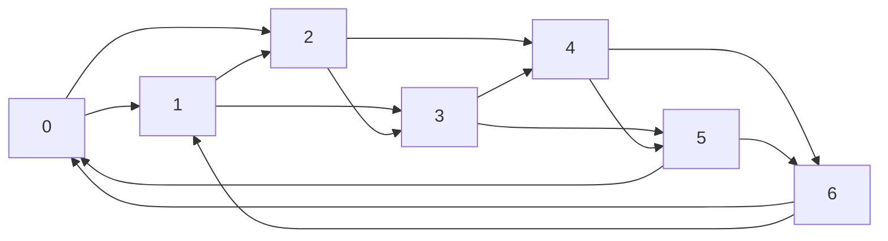

# Assignment 4: Uniform Traffic

## What “uniform” means

There are `n` nodes. For every pair of distinct nodes `i` and `j`, the traffic
from `i` to `j` is

```text
T[i][j] = d / (n - 1),    i != j
T[i][i] = 0
```

Thus every source sends `d` units total, split equally among the other `n - 1`
nodes. These are traffic volumes, not necessarily indivisible transactions.

## What we choose

We choose the directed links between the `n` nodes. Each node must have exactly
`d` outgoing links and `d` incoming links, and each link has capacity 1. Traffic
can be routed along paths in the resulting graph. The goal is to maximize the
concurrent-flow scale `lambda`: all demands `T[i][j]` are multiplied by
`lambda`, while no link carries more than its capacity.

## A simple candidate topology

Label nodes `0, 1, ..., n-1`. For each node `i`, add directed links from `i` to
the next `d` nodes around a ring:

```text
for i = 0, ..., n-1:
    for k = 1, ..., d:
        add link i -> (i + k) mod n
```

For `d <= n - 1`, this gives each node `d` outgoing links. Each node also has
`d` incoming links, from the `d` nodes immediately before it around the ring.
This is a convenient candidate because its construction is symmetric and easy
to explain.

### Example: `n = 7`, `d = 2`

Each node links to the next two nodes clockwise. The wraparound at node 6 goes
back to nodes 0 and 1:



Each node has two outgoing and two incoming links. This diagram illustrates
the candidate construction; it does not by itself establish that the topology
is optimal.

## Important: a candidate is not yet an optimality argument

The ring construction satisfies the degree constraints, but that does not by
itself show it maximizes concurrent flow. A complete answer needs to:

1. Establish an upper bound on `lambda` that applies to every allowed topology.
2. Show that the proposed topology can achieve that bound, or compare it
   against all alternatives with a valid argument.

One useful bound comes from any set of nodes `S`: the traffic demanded from
`S` to its complement is

```text
lambda * |S| * (n - |S|) * d / (n - 1)
```

and must cross the directed links leaving `S`. Since each such link has
capacity 1, this gives

```text
lambda <= (number of links from S to its complement)
          / (|S| * (n - |S|) * d / (n - 1)).
```

This is a starting point for deriving a topology-independent bound; it still
needs to be paired with a construction that attains the bound.

Another basic observation: when `d < n - 1`, some ordered pair has no direct
link. At `lambda = 1`, total offered traffic is `n*d`, equal to the total
capacity of all `n*d` links. Routing any positive amount over a path of length
greater than one uses more than one unit of link capacity per unit of demand,
so `lambda = 1` is impossible in that case.

## Next step

Choose concrete values of `n` and `d` (or keep them symbolic), then calculate
the candidate topology's achievable `lambda` and look for a matching
upper-bound proof. Do not claim the ring is optimal until those two values
match and the argument covers every allowed topology.
